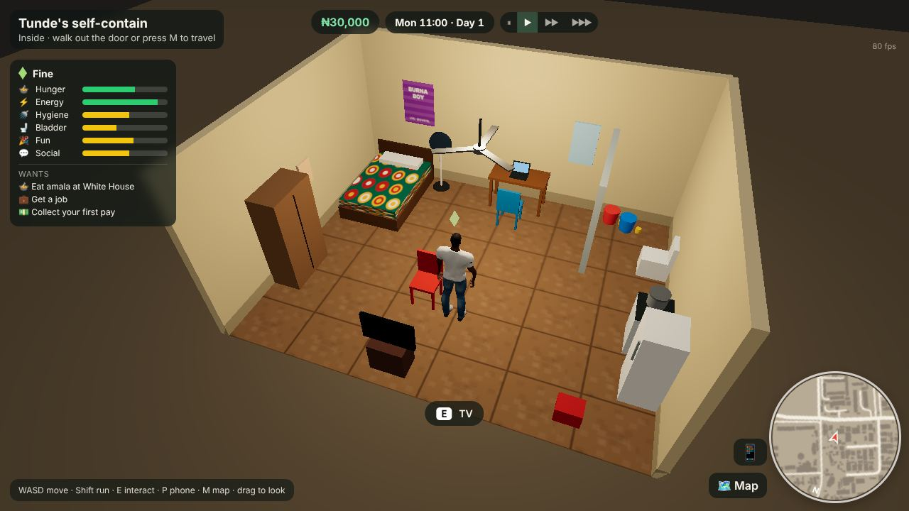
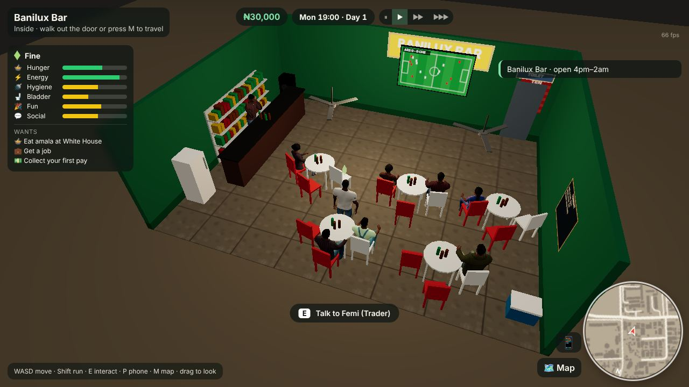
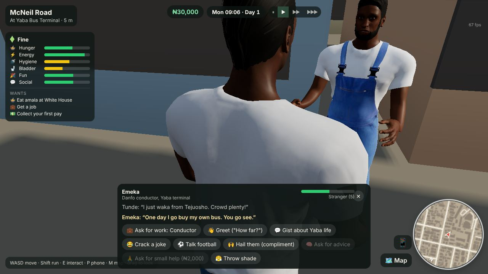
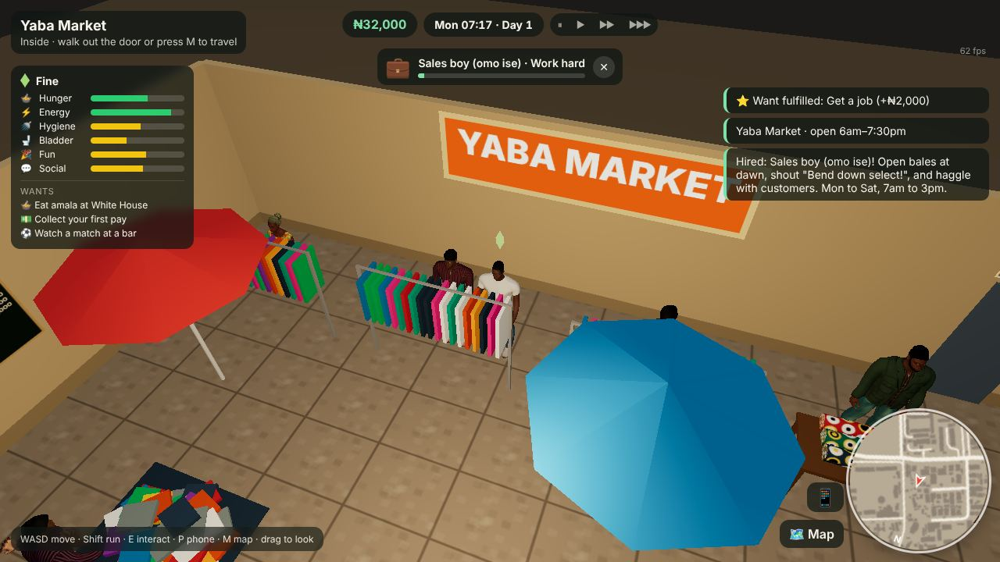
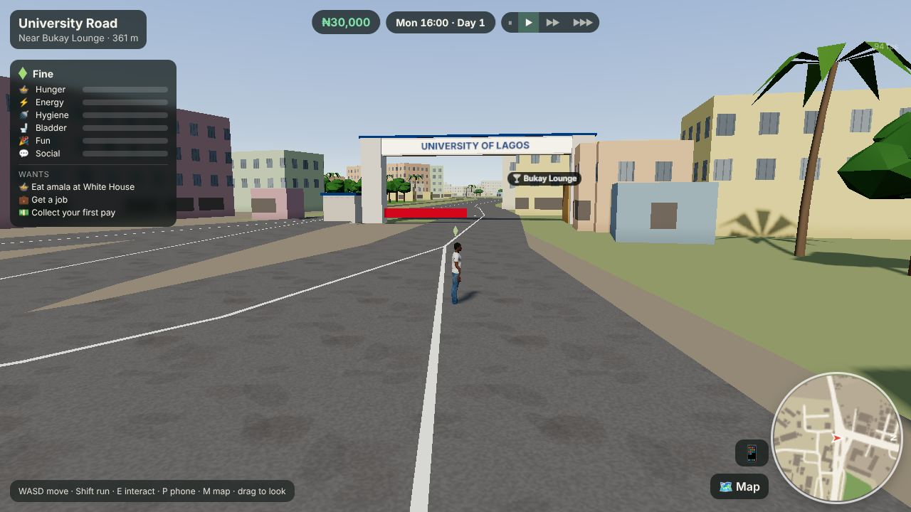
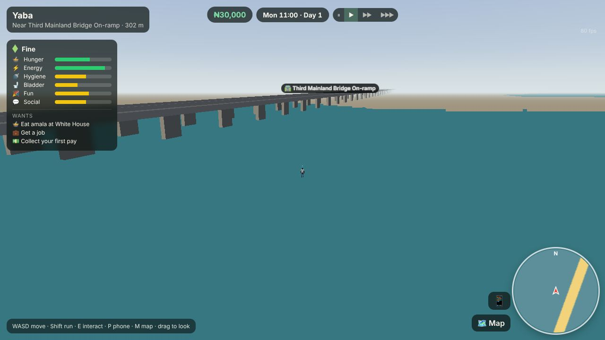

# Yaba Life

A Nigerian life simulation for the web, built city by city. The first city is **Yaba, Lagos**, generated from the real map: every street, building footprint, lagoon edge and campus outline comes from OpenStreetMap data.

It runs straight in the browser (no install) and is designed to stay light on CPU and GPU so it plays smoothly on ordinary laptops and phones.


| UNILAG | Night on Herbert Macaulay | Full map |
| --- | --- | --- |
|  |  |  |

## What's playable now

**A life sim, Sims-style, in real Yaba.** Wake up in Tunde's self-contain, keep him fed, rested, clean and happy, find work, earn naira and pay Baba his rent before the week runs out.

| Home | Banilux Bar on match night | Talking to Emeka |
| --- | --- | --- |
|  |  |  |

| A shift at Yaba Market | UNILAG main gate | Third Mainland Bridge |
| --- | --- | --- |
|  |  |  |

- **Needs and mood**: hunger, energy, hygiene, bladder, fun and social drain over time; mood and a plumbob above Tunde's head follow them. Run one dry and there are consequences (fainting, a hospital bill, passing out on the street).
- **Enterable buildings**: walk up to a door and press E. Homes, bukas (White House, Belleful), bars with football on the TV, lounges and clubs, E-Centre's cinema, markets, Mallmart, CcHUB, UNILAG, YABATECH, hospitals and hotels each have a furnished interior with a Sims-style cutaway camera.
- **People**: Baba the landlord, Iya Bisi at Yaba Market, Emeka the danfo conductor, Chidi the barman, Kemi the developer at CcHUB, Amaka the UNILAG student and Mallam Sani the suya man keep daily schedules around the city, plus street crowds and bar patrons. Talk to anyone: greet, gist, crack jokes, talk football, ask for work or small help. Replies are in Pidgin and relationships go up and down.
- **Work and earn**: four jobs with levels, promotions and work styles: market sales boy, danfo conductor, barman and junior developer. Pay is in naira per shift; miss too many shifts and you're sacked. Hawk pure water when you're broke.
- **Lagos life**: weekly rent, NEPA taking light at home (buy generator fuel), danfo, keke and Bolt with rush-hour go-slow, skills (coding, hustle, charisma, cooking), wants with rewards, a phone with your job, skills, contacts and bank history.
- **Landmarks that look like themselves**: the Third Mainland Bridge and the Ojuelegba and Yaba flyovers raised on pillars from OSM bridge data, the UNILAG main gate and Senate House tower, YABATECH, Queen's College and Neuro-Psychiatric Hospital gates, the tent-roofed Yaba bus terminal full of yellow danfos, the Red Line station, Tejuosho's mall front, E-Centre's glass and Ozone sign, CcHUB, Banilux and more.
- **Real Yaba**: 42,500 buildings, 2,800 road and rail segments, the lagoon, campuses, markets and parks inside a 5 × 3.9 km box covering Yaba, Akoka/UNILAG, Ebute Metta, Sabo, Iwaya and Makoko.

The design notes, including what was borrowed from The Sims, are in [docs/life-sim-design.md](docs/life-sim-design.md).

## Controls

| Action | Keyboard / mouse | Touch |
| --- | --- | --- |
| Move | WASD or arrow keys | Left thumb joystick |
| Run | Hold Shift | Push the joystick to the edge |
| Interact (enter, talk, use) | E, then pick from the menu (or press 1 to 9) | ✋ button |
| Phone (job, skills, people, wants, bank) | P | 📱 button |
| Time speed | Pause, 1×, 4×, 12× buttons at the top (Space pauses, 1 to 3 pick a speed) | Same buttons |
| Look around | Drag with mouse, Q/R to turn | Drag on the right side |
| Zoom | Mouse wheel | |
| Map and travel | M | Map button |

Your game saves in the browser automatically. Handy URL options: `?new` starts a fresh life, `?t=20.5` sets the time of day, `?q=low` forces the low quality preset, `?at=x,z` spawns outside at local coordinates.

## Run it

```bash
npm install
npm run dev        # http://localhost:5173
npm run build      # static site in dist/, deployable anywhere
```

Pushing to `main` deploys to GitHub Pages via `.github/workflows/pages.yml`.

## How it is built

- **Stack**: Three.js + TypeScript + Vite. No game engine, no server.
- **Map pipeline** (`tools/`): `fetch_overture.py` pulls only the parquet row groups covering Yaba from the [Overture Maps](https://overturemaps.org) release on S3 (OpenStreetMap-derived). `build_map.py` projects everything to local metres and packs it into `public/data/yaba.bin` (1 MB of int16 geometry) plus `yaba.json` (names, landmarks). Landmarks from the research notes are snapped to their OSM features by hand-checked names.
- **Performance**: geometry is generated in a Web Worker, merged into 320 m chunks (a few draw calls each), far chunks are hidden, trees are instanced, windows are drawn by a shader instead of geometry, the sun's shadow map only covers the area around the player, and resolution adapts automatically if the frame rate drops.
- **Character pipeline** (`tools/character/`): `build_character.py` generates the player from [MakeHuman](http://www.makehumancommunity.org) CC0 assets: it morphs the base mesh (young adult, African ethnicity), fits clothes, hair, eyes and brows, collapses the 163-bone rig to a 77-bone game rig, authors idle/walk/run procedurally, and writes one 1.7 to 2.4 MB GLB per person, with idle, walk, run, talk, work, sit, eat, dance and sleep clips. The cast (Tunde plus seven Yaba residents) are JSON presets in `tools/character/presets/`, including procedural ankara prints and age blending.

```bash
# regenerate the map
pip install pyarrow shapely numpy
python3 tools/fetch_overture.py
python3 tools/build_map.py --research path/to/yaba-places.json

# regenerate the character
pip install numpy pillow
scripts/fetch-makehuman.sh
python3 tools/character/build_character.py
```

## Roadmap

1. Moving traffic: danfos, keke and okada driving the real roads.
2. More jobs and careers (okada rider, POS agent, nurse, lecturer), owning a business, and moving to a bigger flat.
3. Relationships that go further: friends who call you out, dating, family.
4. Next cities.

## Credits and licences

See [CREDITS.md](CREDITS.md). Code is MIT. Map data is © OpenStreetMap contributors under the ODbL.
