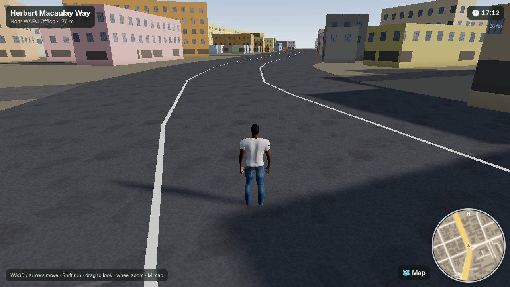
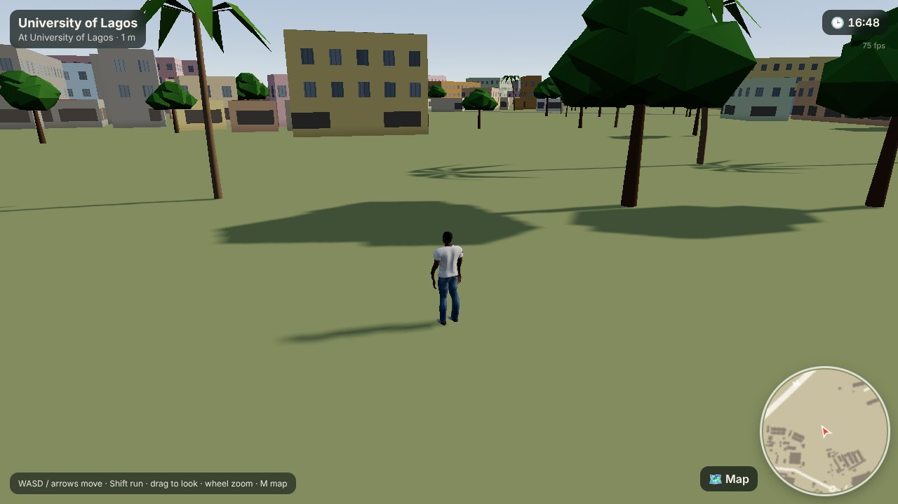
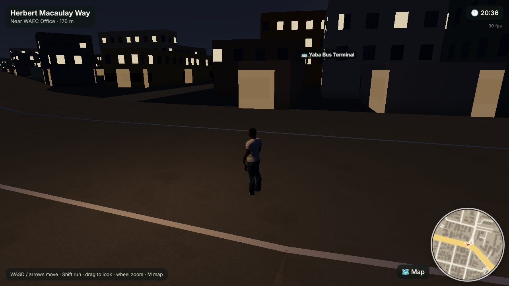
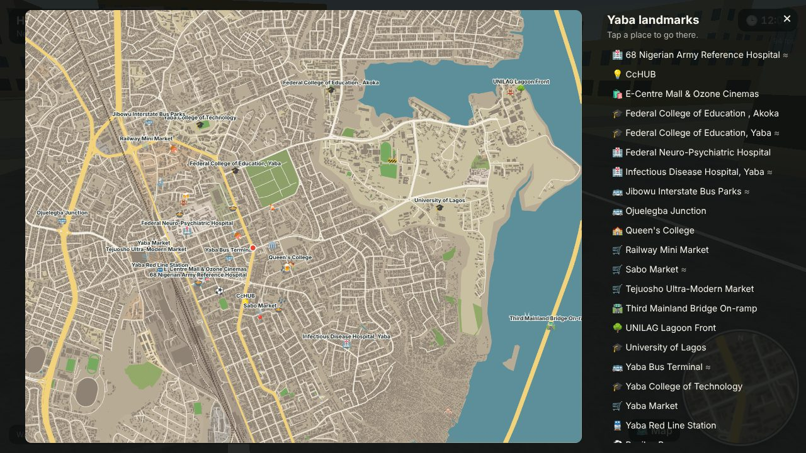

# Yaba Life

A Nigerian life simulation for the web, built city by city. The first city is **Yaba, Lagos**, generated from the real map: every street, building footprint, lagoon edge and campus outline comes from OpenStreetMap data.

It runs straight in the browser (no install) and is designed to stay light on CPU and GPU so it plays smoothly on ordinary laptops and phones.



| UNILAG | Night on Herbert Macaulay | Full map |
| --- | --- | --- |
|  |  |  |

## What's playable now

- **Real Yaba**: 42,500 buildings, 2,800 road and rail segments, the lagoon, campuses, markets and parks inside a 5 × 3.9 km box covering Yaba, Akoka/UNILAG, Ebute Metta, Sabo, Iwaya and Makoko.
- **Landmarks** placed from the map: UNILAG, YABATECH, FCE Akoka, Queen's College, Tejuosho Market, Yaba Market, E-Centre/Ozone, Yaba railway station, Ojuelegba, CcHUB, the Third Mainland Bridge and more, plus the lounges and spots from the Yaba research notes.
- **Tunde**, a realistic young Nigerian man (white tee, jeans, sneakers) with idle, walk and run animations.
- Third-person controls, building collision, a minimap that names the street you're on, a full map with fast travel, a Lagos day/night cycle with lit windows after dark.

## Controls

| Action | Keyboard / mouse | Touch |
| --- | --- | --- |
| Move | WASD or arrow keys | Left thumb joystick |
| Run | Hold Shift | Push the joystick to the edge |
| Look around | Drag with mouse, Q/E to turn | Drag on the right side |
| Zoom | Mouse wheel | |
| Map and fast travel | M | Map button |

Handy URL options: `?t=20.5` sets the time of day, `?q=low` forces the low quality preset, `?at=x,z` spawns at local coordinates.

## Run it

```bash
npm install
npm run dev        # http://localhost:5173
npm run build      # static site in dist/, deployable anywhere
```

Pushing to `main` deploys to GitHub Pages via `.github/workflows/pages.yml`.

## How it is built

- **Stack**: Three.js + TypeScript + Vite. No game engine, no server.
- **Map pipeline** (`tools/`): `fetch_overture.py` pulls only the parquet row groups covering Yaba from the [Overture Maps](https://overturemaps.org) release on S3 (OpenStreetMap-derived). `build_map.py` projects everything to local metres and packs it into `public/data/yaba.bin` (1 MB of int16 geometry) plus `yaba.json` (names, landmarks). Landmarks from the research notes are snapped to their OSM features by hand-checked names.
- **Performance**: geometry is generated in a Web Worker, merged into 320 m chunks (a few draw calls each), far chunks are hidden, trees are instanced, windows are drawn by a shader instead of geometry, the sun's shadow map only covers the area around the player, and resolution adapts automatically if the frame rate drops.
- **Character pipeline** (`tools/character/`): `build_character.py` generates the player from [MakeHuman](http://www.makehumancommunity.org) CC0 assets: it morphs the base mesh (young adult, African ethnicity), fits clothes, hair, eyes and brows, collapses the 163-bone rig to a 77-bone game rig, authors idle/walk/run procedurally, and writes one 1.7 MB GLB. New characters are a JSON preset away (`tools/character/presets/`).

```bash
# regenerate the map
pip install pyarrow shapely numpy
python3 tools/fetch_overture.py
python3 tools/build_map.py --research path/to/yaba-places.json

# regenerate the character
pip install numpy pillow
scripts/fetch-makehuman.sh
python3 tools/character/build_character.py
```

## Roadmap

1. People on the streets: traders, okada and keke riders, students, 9-5 workers on daily schedules.
2. Life sim loop: needs, money, jobs, rent, buying food at Tejuosho, nights out at the lounges.
3. Vehicles: danfo buses, keke, okada along the real roads.
4. More character presets (women, elders, traders) and outfits (ankara, agbada, uniforms).
5. Next cities.

## Credits and licences

See [CREDITS.md](CREDITS.md). Code is MIT. Map data is © OpenStreetMap contributors under the ODbL.
